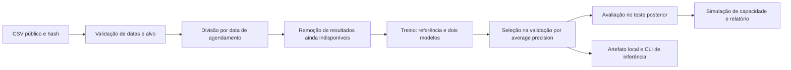

# Clinic No Show ML

Primeiro projeto de aprendizado em machine learning preditivo de Gabriel William de Paulo, preparado com apoio do Codex. Estima risco de falta em consultas a partir de informações operacionais conhecidas no agendamento e avalia uma fila limitada de lembretes. A motivação vem da experiência relatada com sistemas e chatbot para clínicas; os dados deste estudo são públicos e não pertencem à VMK nem a clientes.

**Estado:** experimento local reproduzível com testes, comparação de modelos e inferência por linha de comando. Sem validação operacional ou integração com clínicas.

## O problema e a decisão

Uma clínica dispõe de capacidade limitada para fazer contato com pacientes. O estudo pergunta se um modelo consegue ordenar agendamentos de modo que uma fração com maior risco concentre mais faltas observadas que uma seleção aleatória esperada. O modelo não determina acesso a atendimento e o experimento não comprova redução de faltas.

O alvo é binário: `1` significa falta e `0` significa comparecimento. É classificação. A primeira comparação usa referência de frequência da classe, regressão logística e histogram gradient boosting. A regressão logística estima probabilidade de classe; apesar do nome, aqui não é uma regressão para prever quantidade ou receita.

## Dados e licença

[Medical Appointment No Shows](https://www.kaggle.com/datasets/joniarroba/noshowappointments), de Joni Hoppen/Aquarela Analytics, versão 5. A página da fonte informa licença **CC BY-NC-SA 4.0**. Consulte as condições na [licença indicada](https://creativecommons.org/licenses/by-nc-sa/4.0/). O estudo usa a amostra histórica de 2016; não se deve presumir representatividade de clínicas atuais.

O CSV bruto e o modelo serializado ficam fora do Git. O download verifica o SHA-256; `data/source.json` registra a procedência. O leitor de dados utiliza somente identificador de consulta para integridade, duas datas e o desfecho. Identificadores de paciente, dados clínicos, sexo, idade, bairro, benefícios sociais e `SMS_received` não entram no modelo. O envio de SMS é excluído porque seu momento e relação com intervenções não estão documentados para previsão no agendamento.

## Como executar

Use Python 3.12. Na pasta do repositório:

```bash
python3.12 -m venv .venv
source .venv/bin/activate
python -m pip install -r requirements.lock
python -m pip install --no-deps -e .
python scripts/download_data.py
python -m pytest -q
noshow-train
noshow-predict --scheduled 2016-05-20T10:00:00Z --appointment 2016-05-27T00:00:00Z
```

O exemplo de inferência usa datas históricas coerentes com o estudo. A saída contém um score/probabilidade estimada, sem calibração externa validada. Só carregue `model.joblib` criado por uma execução confiável deste projeto, pois a desserialização com joblib pode executar código.

## Fluxo



## Avaliação que respeita o tempo

A divisão usa datas de agendamento em janelas aproximadamente 70/15/15, com dias inteiros em cada conjunto. Um agendamento antigo pode ter consulta marcada no futuro: nesse caso o resultado ainda não seria conhecido ao treinar o modelo. Esses registros são removidos do treino/validação quando o dia da consulta ainda não terminou na próxima fronteira temporal. O relatório registra as quantidades removidas e as janelas reais.

As transformações aprendidas da regressão logística são ajustadas apenas no treino usando Pipeline. A escolha do modelo usa average precision na validação, incluindo a referência como candidata. O conjunto de teste não escolhe modelo ou hiperparâmetros. A avaliação inicial é mantida como referência; mudanças motivadas pelo teste requerem novo conjunto de avaliação ou validação temporal adicional.

As variáveis são antecedência em dias, hora UTC do agendamento, dia da semana do agendamento, dia da semana da consulta e indicador de consulta no mesmo dia. O horário local da fonte não foi verificado; usamos consistentemente as datas UTC fornecidas e documentamos essa limitação.

## Resultados e interpretação

Veja [o relatório calculado](reports/RESULTS.md) e [as métricas completas](reports/metrics.json). Acurácia sozinha não demonstra utilidade em dados com classes desbalanceadas. O relatório inclui average precision, ROC AUC, Brier, log loss e precisão/recall no limiar ilustrativo de 0,5.

A simulação ordena os scores do teste e seleciona 20% dos agendamentos. Mede quantas faltas históricas aparecem nesse grupo e compara sua concentração com a expectativa aleatória. O orçamento de 20% é uma hipótese didática sobre o conjunto completo, não capacidade diária validada. Empates usam a ordem estável dos registros. Não mede benefício causal de lembretes, pacientes recuperados, retorno financeiro ou desempenho em outra clínica.

## Engenharia e testes

- Contrato único de variáveis entre treino e inferência.
- Falha explícita para rótulos desconhecidos e identificadores de consulta ausentes/duplicados.
- Datas inválidas ou consulta anterior ao agendamento são contabilizadas e excluídas no treino; inferência inválida é rejeitada.
- Testes para vazamento por colunas, disponibilidade temporal de resultados, datas no mesmo dia, métricas de capacidade e integração entre treino/artefato/inferência.
- Dependências fixadas, seed registrada e workflow de testes no GitHub Actions.

## Limitações e próximas etapas

A amostra é antiga e cobre uma janela curta de consultas. Pacientes podem aparecer em datas diferentes; não há validação específica em pacientes novos ou outra clínica. O corte temporal e a remoção de resultados não observados alteram a composição das janelas; as taxas de faltas por conjunto precisam ser examinadas. Os scores não têm calibração externa. Não há serviço de produção, monitoramento de drift, comprovação de impacto ou avaliação por grupos.

Próximas evoluções possíveis: explicar os resultados por janela, estudar a diferença entre limiar e ranking, validação temporal em múltiplas janelas, comparação com uma regra simples de antecedência, calibração e testes de estabilidade. Uma API pode ser adicionada depois do entendimento da primeira versão.

## Autoria e aprendizado

Gabriel ainda não havia construído modelo preditivo ao iniciar este projeto. O código inicial, os testes e a execução foram preparados com assistência do Codex. Isso não representa experiência prévia de Gabriel em treinar modelos nem domínio independente já demonstrado. O objetivo é executar, compreender, questionar e evoluir a solução, registrando contribuições e decisões próprias. O [roteiro de estudo](docs/LEARNING.md) guia essa etapa.

## Licenças

Código original: [MIT](LICENSE). Fonte de dados: CC BY-NC-SA 4.0, conforme a página do autor; dados brutos não são redistribuídos. Relatórios derivados deste experimento são disponibilizados sob CC BY-NC-SA 4.0, com atribuição à fonte. Dependências mantêm suas próprias licenças.
